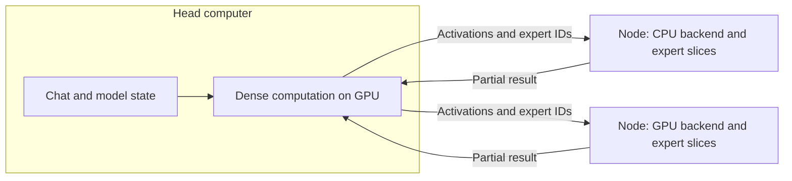

# How Fronk works

Fronk lets several computers run one large language model together. The aim is
to use the machines you have: a GPU machine for the dense computation, and
other computers contributing memory and expert computation. They can have
different processors, operating systems and memory sizes.

The current model is **Qwen3.8-Flash-Next-Q4.gguf**, a mixture-of-experts model
with a 125B-parameter backbone. An *expert* is a feed-forward network selected
by the model for a particular input. Only a few experts are active at once,
but all their weights must be available. Fronk spreads those weights and the
work over the cluster.

To try it, follow the [installation guide](docs/INSTALL.md). This document
explains how to choose and connect the machines, why the work is divided this
way, and how to find the implementation.

**In this guide:**
[head and nodes](#head-and-nodes-are-different-components) ·
[cables](#physical-topology-is-part-of-the-design) ·
[what each machine needs](#what-each-machine-needs) ·
[startup](#startup-head-first-then-nodes) ·
[why neuron slices](#why-divide-experts-into-neuron-slices) ·
[measurements](#what-the-measurements-tell-us) ·
[balancing](#balancing-compute-storage-and-communication) ·
[communication](#communication-control-plane-and-data-plane) ·
[where to find things](#where-to-find-things) ·
[extend Fronk](#extend-fronk-or-get-help)

## Head and nodes are different components

The **head** runs the dense part of the model on its GPU: attention and recurrent
state, routing, and the rest of the computation needed to choose tokens. It
coordinates the expert work and provides the chat interface. The original model
file stays on storage accessible to the head.

A **node** runs an expert worker. It stores its assigned neuron slices, receives
an activation and selected expert IDs from the head, computes a partial result,
and sends that result back. It does not run the dense model or choose the next
token. Nodes communicate with the head, without exchanging activations with
one another.



The same installer sets up either component. Choose **Head** on one computer
and **Node** on the others. The head may also own expert slices: its local
worker follows the same compute contract as a remote node. This is useful when
the head has spare memory and compute capacity.

A **node backend** implements that compute contract for a particular CPU or
GPU. It is separate from the head's dense engine. Adding a backend lets a node
use different hardware while keeping the same installer, planner and network
protocol. It does not by itself add a new dense-head engine.

## Physical topology is part of the design

The head sends expert work and waits for results at **48 layer boundaries** in
a forward pass. Nodes work in parallel, but the next dense step needs their
combined result. Low latency and enough return bandwidth matter at every one
of those boundaries.

Use either separate direct links or a switch with a faster head connection:

```text
Direct Thunderbolt links                   Ethernet switch

             ┌─ head port 1 ─ node A        head ── 10 Gb/s ── switch
head ────────┤                                                ├─ 1 Gb/s ─ node A
             └─ head port 2 ─ node B                         ├─ 1 Gb/s ─ node B
                                                             └─ 1 Gb/s ─ node C
```

For Thunderbolt, use a suitable cable and a separate physical head port for
each node. A hub or daisy chain shares its upstream link; even separate ports
may share a controller. On a switch, all replies converge on the head port.
A faster head-to-switch link keeps that port from serializing every node's
traffic at the speed of a single node link. The adapter, cable and switch port
must all support the intended speed. **Gb/s means gigabits per second.**

An extra 0.5 ms on the critical path adds about 24 ms across 48 rounds. A
uniform 1 Gb/s network can work, but its shared head link limits scaling.
Wi-Fi is supported with less predictable latency. Mixed Ethernet and
Thunderbolt connections are supported.

Use a trusted IPv4 local network. Fronk discovers machines and measures paths;
the operating system must already provide working addresses and routes.
[NETWORK.md](docs/NETWORK.md) explains cables, addresses and the macOS/Linux
steps without assuming networking experience. The installer does not require
SSH or change those network settings for you.

## What each machine needs

| Component | Supported execution path | Capacity to allow for |
|---|---|---|
| Apple Silicon head | Dense engine on Metal | Dense weights, context and runtime memory; SSD for the original GGUF and local units |
| Intel Mac or Linux GPU head | Vulkan adapter; MoltenVK on macOS | A compatible GPU/driver passing the installer probe; dense/output weights alone need 5.40 GB of free GPU memory, plus context and scratch space |
| x86 node | AVX2 backend, requiring AVX2/FMA/F16C | Available memory and disk space for its assigned units |
| ARM node | NEON backend | Available memory and disk space for its assigned units |
| Apple Silicon node | Metal or NEON backend | Available unified memory; Metal can also use calibrated RAM + SSD placement |
| Another compute architecture | Portable reference backend or a custom backend | Enough capacity for its share; a specialized backend is needed for useful accelerator performance |

Apple Silicon is the performance-tested head path. A head GPU probe checks
the installed device; it is not a throughput prediction for another GPU.
The supplied programs target macOS and Linux. Installation requires a compiler
toolchain; the graphical manager also needs Python with Tk. The
[installation prerequisites](docs/INSTALL.md#before-starting) list these tools.

For this model, expert storage is divided into **20 units of 3.35 GB**, about
**66.94 GB** in total. The complete plan must cover all 20 units. A machine can
own several units; the planner gives more work to machines that can finish it
in time. Available RAM matters, rather than installed RAM alone. The head
reserves memory for dense computation and context before offering any to its
local expert worker.

Metal's RAM + SSD backend can keep some assigned expert units on disk and read
the needed weights during computation. Its measured read-and-compute cost
participates in planning. This is separate from operating-system swap; a slow
disk can become the limiting component.

The head needs the exact **177.28 GB GGUF** on an internal or external SSD.
That file includes dense weights and a disk-backed n-gram table as well as
the expert weights. It need not all be resident in RAM. Allow additional disk
space for prepared units, up to another 66.94 GB on the head. Nodes need disk
space for their own units, including when those units run from RAM. See
[MODEL.md](docs/MODEL.md) for the file, download and verification details.

## Startup: head first, then nodes

Start the installer on the head. It checks the GPU, creates the node roster
and tells you when to open the installer on each node. Each node selects its
name, pairs with the head and calibrates its backend. Both the graphical and
terminal managers run this same workflow.

Before a model download, the **synthetic demo** uses generated weight data and
real computation and communication on the selected machines. It shows whether
the whole model can be placed, where time is spent and an estimated speed.
It does not prepare or assign the real model slices yet. This lets you try the
hardware arrangement before downloading 177 GB.

Compute profiles are saved. Reconnecting reuses compatible profiles while
checking current memory and network paths. The planner chooses shares using
those costs. Once you select the real GGUF, Fronk checks its identity, extracts
compact units, transfers missing units and verifies their hashes. A numerical
check and actual generation precede chat. The web console shows these stages
and the work assigned to each machine.

If a step stops, keep its error and use [the recovery guide](docs/TROUBLESHOOTING.md).
Reopening the manager lets you continue from saved configuration and verified
files. The [installation guide](docs/INSTALL.md) covers the exact choices.

## Why divide experts into neuron slices?

Each routed expert has 640 intermediate neurons. Fronk cuts that dimension into
20 groups of 32. A stored unit contains the **same neuron range in every expert
and every distributed layer**. For example, unit 2 owns neurons 64–95; it does
not own expert 2. A node assigned two units handles 64 neurons of every expert.

The head selects ten routed experts for each input. Every participating node
has its slice of those experts and can immediately do its share. A small CPU
can therefore contribute a small fraction of the work, while faster machines
handle complementary ranges. The assignment does not depend on which experts
happen to be selected.

The split works because the intermediate activation is elementwise. For one
expert and an owned neuron range `S`, the calculation is:

```text
h[S] = SiLU(gate[S, :] × x) * (up[S, :] × x)
partial[S] = down[:, S] × h[S]
expert output = sum of partial[S] over all disjoint neuron ranges
```

Here `x` is the full 2,560-value input, and `*` is elementwise multiplication.
Each node owns both the input projections and the corresponding output columns,
so it can finish this calculation without a network exchange in the middle.
It weights and adds the selected experts locally, returning one 2,560-value
partial per input. The head adds the nodes' partials. The shared expert is
normally computed on the head GPU.

| One routed expert, one layer | Whole expert | One slice |
|---|---:|---:|
| Gate and up matrices, each | 640 × 2,560 | 32 × 2,560 |
| Down matrix | 2,560 × 640 | 2,560 × 32 |
| Quantized weight bytes | 2,713,600 | 135,680 |

The 32-neuron cut matches the down matrix's quantization block. Preparation
copies the required rows and column blocks into compact files without
requantizing them. Kernels read useful bytes together, rather than repeatedly
stepping across unused portions of a full matrix. A unit holds all 512 routed
experts plus the shared expert across 48 layers, totaling 3,347,005,440 bytes.
The extractor has been checked byte by byte against the original tensor
coordinates and against the expected digests of all 20 units.

### Why use this split on a mixed cluster?

| Division of work | Consequence for one chat on unequal machines |
|---|---|
| A complete model per computer | Serves independent requests, but each computer must hold and run a model |
| Different layers on different computers | A token passes through the machines in order; a slow stage adds to serial latency, although fewer network exchanges can help on slow links |
| Whole experts on different computers | Work follows routing; a selected expert on a slow machine must be computed there in full |
| Fronk's neuron slices | Every selected expert is divided among the machines in measured proportions; every assigned machine must return its partial at each layer |

The useful property is a small, adjustable share of every expert. The cost is
frequent synchronization. Giving one machine all 20 units does not reduce the
arithmetic, and adding a node helps only if the compute it removes from the
slowest participant outweighs the communication it adds.

## What the measurements tell us

This is the first public version. The design is open to correction, and reports
from other people's hardware are part of the work. [About the project](docs/ABOUT.md)
introduces its author; [the real test cluster](docs/TEST_CLUSTER.md) includes
hardware, allocations, console screenshots and the iMac's measured imbalance.

On a Shuttle with an Intel i5-10210U, ten active experts per layer were evaluated
over four resident layers. Full 640-neuron work took **6.318 ms**; a compact
64-neuron share took **0.781 ms**. With the same kernels, packing that share
reduced its time from **1.689 to 0.781 ms** compared with indexing into full
matrices. A separate resident 64-neuron test across all 48 layers took
**9.658 ms** on average. These are expert-compute times, which explain the
choice of small, physically compact slices.

A complete cluster combined these machines:

| Machine | Memory | Work |
|---|---:|---|
| MacBook Pro M4 Pro | 24 GiB | Metal dense head; 2 local RAM units + 1 SSD unit |
| Intel iMac, i5-7600K | 48 GiB | AVX2 node, 10 RAM units, Thunderbolt |
| MacBook Pro M1 Pro | 16 GiB | Metal node, 3 RAM units, Thunderbolt |
| Shuttle, i5-10210U | About 16 GB | AVX2 node, 4 RAM units, Gigabit Ethernet |

This arrangement covered all 20 units. One short-prompt test recorded **15.50
streamed fragments/s** at median warm decode, and **15.35 after reconnect**.
The benchmark counted text fragments, without an independent tokenizer count.
The two Apple Silicon machines used their integrated GPUs; the Intel
nodes computed on CPUs.

The significance is that these different computers can contribute to a complete
generation, including a measured SSD share. Your result depends on usable
memory, the slowest computation, the head GPU, links, disk and workload.
[MEASUREMENTS.md](docs/MEASUREMENTS.md) gives the width curve, projected
token-equivalent expert rates, complete-chat method and raw evidence.

Use the [model API](docs/API.md) to connect another chat interface or agent.
Use **Report → Save cluster report** in the console to prepare a reviewable
configuration/result file for a [community report](docs/SHARE.md).

[Homogeneous-node projections](docs/PROJECTIONS.md) consider ten 64-neuron
Shuttles and clusters of M1 Pros behind the same M4 Pro head. They separate
measured backend costs from assumed return-network time and MTP acceptance.

## Balancing compute, storage and communication

The planner chooses how many units each participant should own by minimizing
the slowest predicted completion time. It combines backend measurements with
link costs and respects capacity. The head's local worker starts before remote
fanout, so it can overlap its computation with communication.

An approximate layer cost is:

```text
dense head time
  + max(local expert time, send + node compute + return for each remote node)
  + join and resume overhead
```

Parallel node times do not add together. A slow last reply matters more than
making an already early node faster. The planner uses measured RAM + SSD curves
where available; costs beyond its measured sweep are estimates. Contention
among several nodes on one shared head uplink is not fully modeled, which is
why the physical layout matters.

Multi-token prediction (MTP) proposes and verifies several tokens together.
Accepted tokens can share weight reads and network rounds. A batch of three
activations does not mean three accepted tokens: the useful gain depends on
verification cost and acceptance. The ordinary Metal head uses MTP and the
calibrated RAM + SSD path. Separate research builds are documented in
[RUN.md](RUN.md).

## Communication: control plane and data plane

The **control plane** prepares a session: discover nodes, authenticate, collect
measurements, choose shares and transfer missing weights. The **data plane**
repeats the activation/result exchanges during generation. Weight files stay
on their owners; they are not resent at each layer.

| Purpose | Protocol and default endpoint | Implementation |
|---|---|---|
| Discover nodes | FRH2 messages over IPv4 UDP 7702 | `connection.c`, `probe.h`, `wire.c` |
| Authenticate, inspect and control | RESP2 over TCP 7700; HMAC-SHA256 authentication | `control.c`, `auth.c`, `resp.c`, `node.c` |
| Transfer a missing unit | Authenticated TCP `RECV`, raw bytes, then SHA-256 verification | `prep.c`, `node.c` |
| Send expert work | FRK1 over UDP 7701, or multicast group 239.7.7.7:7702 | `fanout.c`, `plane.c`, `wire.c` |
| Return partials | FRK1 over UDP to the head's session socket | `plane.c`, `wire.c` |
| Local API and console | HTTP on loopback ports 7710 and 7730 | `serve.c`, `tools/fronk-web.py` |

Connections, workers and buffers persist across layer calls. A request is sent
as one datagram per destination or eligible multicast group; replies carry
session, step and layer identity. The head rejects stale and duplicate pieces
and requires every assigned participant. A missing slice fails generation.
The LAN traffic is authenticated for control but not encrypted. See
[PROTOCOL.md](docs/PROTOCOL.md) for framing, ports, deadlines and error behavior.

## Where to find things

| Area | Files | Start reading here |
|---|---|---|
| Commands and defaults | [main.c](src/main.c), [config.c](src/config.c), [runtime.c](src/runtime.c) | `main`, `config_load`, `fr_head_defaults` |
| Head lifecycle | [head.c](src/head.c), [head.h](src/head.h) | `head_main`, `head_demo_main` |
| Discovery and paths | [connection.c](src/connection.c), [discovery.c](src/discovery.c), [interfaces.c](src/interfaces.c) | `connection_run` |
| Backend choice and costs | [selection.c](src/selection.c), [bench.c](src/bench.c), [hybrid.c](src/hybrid.c), [setup.c](src/setup.c) | `selection_sweep_local`, `selection_hybrid_calibrate` |
| Load balance | [planner.c](src/planner.c) | `planner_shares`, `planner_compute_shares` |
| Node control | [node.c](src/node.c), [ae.c](src/ae.c), [resp.c](src/resp.c), [auth.c](src/auth.c) | `node_run`, `dispatch`, `session_command` |
| One distributed layer | [plane.c](src/plane.c), [fanout.c](src/fanout.c), [wire.c](src/wire.c) | `fr_head_plane_run`, `receive_loop`, `fanout_send` |
| Weights and slices | [prep.c](src/prep.c), [units.c](src/units.c), [native.c](src/native.c) | `fr_slice_copy`, `fr_unit_stream`, `fr_native_dot` |
| Dense engine bridge | [serve.c](src/serve.c), [fronk_client.h](client/fronk_client.h) | `moe_hook`, `serve_call`, `fr_serve_start` |
| Backend contract | [backend.h](src/backend.h), [backend.c](src/backend.c) | `fr_backend`, `fr_req`, `fr_part` |
| Kernels | [ref.c](backends/ref.c), [neon.c](backends/neon.c), [avx2.c](backends/avx2.c), [metal.m](backends/metal.m) | Backend table at the end of each file |
| SSD reads | [ssd.c](src/ssd.c), [ssd.h](src/ssd.h) | `fr_ssd_load`, cache and read-worker lifecycle |
| Console and chat | [fronk-web.py](tools/fronk-web.py), [fronk-web.html](tools/fronk-web.html), [fronk-chat.html](tools/fronk-chat.html) | Process control, status parsing, chat proxy |
| Installer | [tools/install](tools/install) | `fronk-install.sh`, `onboard.sh`, `service.sh`, `manager.py` |
| Metal engine build | [tools/engine](tools/engine), [stage-ds4.sh](tools/mtp/stage-ds4.sh) | Pinned upstream patch and source manifest |
| Vulkan head | [tools/gpu-head](tools/gpu-head) | Build, GPU probe, expert hook and launcher |
| Tests | [tests](tests) | Small fixtures and numerical checks |

### A first reading of the code

Start with [backend.h](src/backend.h), then `run` in
[user-template.c](backends/user-template.c). A `fr_req` supplies a layer,
activation rows, expert IDs and gates; a `fr_part` returns the contribution of
the owned units. The template spells out the calculation without SIMD or GPU
machinery.

Next follow `fr_head_plane_run` in [plane.c](src/plane.c). It rounds inputs to
the same FP16 values locally and remotely, submits local work, sends requests,
collects replies and publishes the complete sum. `fr_assembly` joins request
fragments on a node; `fr_accumulator` joins replies on the head. Their bitmaps
prevent a duplicate packet from adding the same numbers twice. Read the
examples in [test_plane.c](tests/test_plane.c) alongside them.

Then read [planner.c](src/planner.c), which chooses **how many** units each
computer gets, and `head_assign` in [head.c](src/head.c), which chooses **which**
units while retaining cached files where possible. The cost curves in
[test_planner.c](tests/test_planner.c) can be worked through on paper.
[prep.c](src/prep.c) turns neuron ranges into compact files.

For installation, [fronk-install.sh](tools/install/fronk-install.sh) and
[onboard.sh](tools/install/onboard.sh) own the workflow;
[manager.py](tools/install/manager.py) displays its questions. The web console
is a separate program that starts the head and follows its phase output.

### Ownership and completion

A backend borrows immutable unit bytes until `unload`. Its `run` calls are
serialized; worker pools and transport buffers are prepared outside the layer
loop. The node's control connection owns the session. Stop and join its receiver
before changing loaded units.

CPU, GPU and SSD buffers must remain live until all submitted work finishes,
including on errors. The head must drain local work even when a send fails.
An accepted MTP prefix updates committed model state; an unverified proposal
does not. These rules are described at their boundaries in the headers and
tested separately from throughput.

## Extend Fronk or get help

For a new CPU or GPU, start with [BACKENDS.md](BACKENDS.md) and the
[named module procedure](docs/BACKEND_MODULES.md). The template gives
you a working scalar calculation; replace its implementation with kernels for
your hardware and run the same numerical checks. The node reports its backend
name and measured costs to the head. A node-only backend does not require a
new head protocol or dense kernel.

A new model needs coordinated layout, extraction, backend and dense-engine
support. The current release accepts one exact model file; changing its name
or configuration is not sufficient. [MODEL.md](docs/MODEL.md) lists the contract.

For a problem, start with [TROUBLESHOOTING.md](docs/TROUBLESHOOTING.md). If you
use a frontier model, give it [the debugging brief](docs/llm/DEBUG.md), the failing step
and the error. For hardware work, give it [the backend brief](docs/llm/BACKENDS.md).
These files point to the code, constraints and checks for that task.

[Share your cluster](docs/SHARE.md) explains how to report a result or a blocked
installation. A solved issue should keep the cause, solution and verification
together so the next person can use it. [CONTRIBUTING.md](CONTRIBUTING.md)
covers code changes and pull requests. [MODULES.md](docs/MODULES.md) maps
review areas and explains the module labels used to organize contributions. [Where to help](docs/IMPROVEMENTS.md)
connects deeper MTP, backend work, SSD reuse and shared-switch communication to
concrete experiments and the files that implement them.
