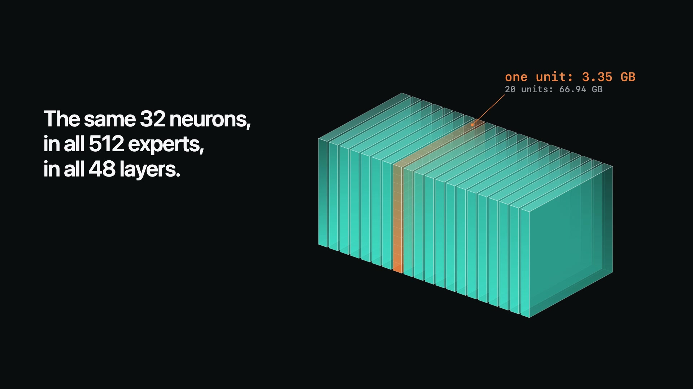
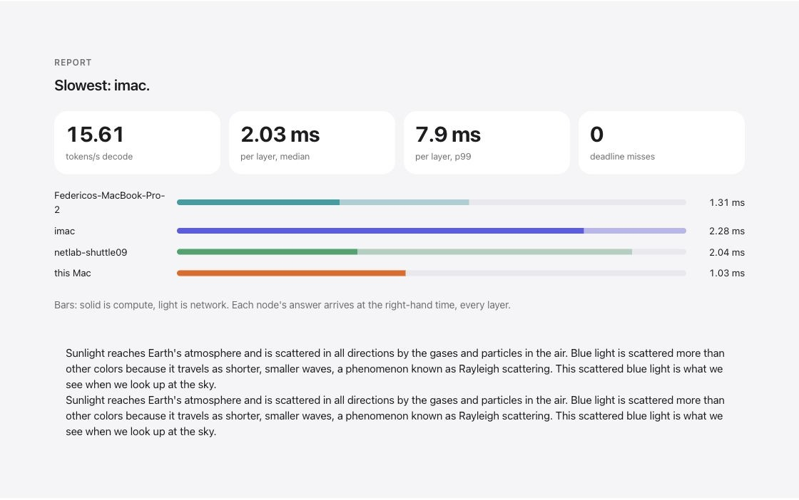

# Fronk

Fronk combines the memory and compute of several computers to run a large
language model locally. A Mac with a GPU can work alongside an Intel desktop,
an ARM machine or a small Linux PC. Each computer handles a share of the work
that fits its capabilities.

**This is the first public version.** It works on the test cluster, but it is
not a finished design. Expect bugs and rough edges I have not found yet.
I am publishing it to learn what works on your machines and to improve it
together. Fronkhensteen is off the laboratory table; its manners still need work.

[Watch the three-minute film](https://github.com/fedesnore/fronk/blob/main/docs/media/fronk-demo.mp4) ·
[Install](docs/INSTALL.md) ·
[All documentation](docs/README.md) ·
[Get help](docs/TROUBLESHOOTING.md) ·
[Ask a frontier model](docs/llm/README.md) ·
[Share your cluster](docs/SHARE.md)

[](https://github.com/fedesnore/fronk/blob/main/docs/media/fronk-demo.mp4)

[](docs/TEST_CLUSTER.md)

*A real console report from [the four computers on my desk](docs/TEST_CLUSTER.md):
a warm short test, not a promise for other machines or conversations. The normal
chat in the film ran at 11–12 tok/s.*

## How it works

The release runs one model: **Qwen3.8-Flash-Next-Q4.gguf**, an open-weight
mixture-of-experts model. Its dense part stays together on one GPU. For each
input, only ten of the 512 experts in a layer are selected. That split is what
makes a mixed cluster possible:

| Component | What it does | What it needs |
|---|---|---|
| **Head** (one computer) | Runs the dense part, including attention, on its GPU; coordinates the nodes and serves chat | A supported GPU, memory for dense computation and context, and the model file on SSD |
| **Node** (the others) | Holds and computes neuron slices of the experts, returning partial results to the head | Available memory, storage and a CPU or GPU with a Fronk backend |

Fronk cuts every expert into 20 slices of 32 neurons. Every node owns a share of
every expert, so it helps whichever experts the model selects. Nodes compute in
parallel and the head adds their results. Measurements of each machine and its
connection decide how many slices it gets. The head waits for the nodes 48 times
per model pass, so the cables matter too. [PROJECT.md](PROJECT.md) explains the
design, the measurements and where each part lives in the code.

## Will it work on your machines?

| What | You need |
|---|---|
| **Head** | Tested: Apple Silicon Mac with Metal (M4 Pro, 24 GiB). Experimental: Intel Mac or Linux with a Vulkan GPU and at least 5.40 GB of free GPU memory |
| **Nodes** | macOS or Linux. x86 with AVX2, ARM with NEON, or an Apple GPU with Metal. A GPU is not required |
| **Memory** | About 67 GB available across all the machines, plus about 10 GB the head keeps for itself. Apple Silicon can also place a measured share on SSD |
| **Disk** | Head: the 177.28 GB model file and up to 66.94 GB of prepared slices. Each node: 3.35 GB per slice it receives |
| **Network** | A trusted local IPv4 network. Best: a Thunderbolt cable to a separate head port for each node, or a switch with a faster link to the head. Wi-Fi works, with less predictable latency |
| **Tools** | A C compiler, `make` and Python 3.9 or newer on every machine; Tk only for the experimental graphical manager |

Windows is not supported. You do not need to work this out in advance: a
**synthetic demo** tests your real machines and cables, and reports whether the
model fits and the estimated speed, before you download anything.

## Install

**Not an expert in networking? Use a frontier model: this is the preferred way.** Open
Codex or Claude Code on the computer with the best GPU and paste the whole of
[`docs/llm/SETUP.md`](docs/llm/SETUP.md). It opens SSH to your computers, connects them,
installs Fronk and checks a real chat. It asks only for what needs your hands or your yes.
You need no networking skills: just read [how to connect the computers physically](docs/NETWORK.md#choose-the-physical-layout).

**Comfortable with terminals and IP addresses?** Follow the steps below, or the
[complete procedure with commands](docs/INSTALL.md#advanced-the-complete-procedure-with-commands).
Download a manager from the [Releases page](https://github.com/fedesnore/fronk/releases/tag/v0.3.0)
and use the same way on every computer. **The terminal is the recommended, more
robust path.** The graphical manager runs the same steps but is experimental: it
has had less testing, so switch to the terminal if it misbehaves.

| Download | Open it | Status |
|---|---|---|
| `fronk-manager.sh` | Run `bash fronk-manager.sh --terminal` | **Recommended** |
| `fronk-manager-macos.zip` | Extract and open **Fronk Installer Manager.app** (not notarized: see [the guide](docs/INSTALL.md#1-open-the-manager-on-the-head)) | Experimental |
| `fronk-manager-linux.tar.gz` | Extract and run **Fronk Setup** | Experimental |

1. **Start on the head.** Choose **Head** and the number of node computers.
2. **Visit each node when asked.** Open the manager, choose **Node**, select the
   assigned name and enter the pairing code from the head.
3. **Return to the head.** Choose **Verify**, then run the synthetic demo.
4. **Select or download the model.** Use a copy on an external SSD or download
   the exact file. Fronk verifies it and sends each node its slices.
5. **Start chat.** Review the plan, choose **Proceed**, and wait for the checks.

SSH is not required. Read the [checklist before you begin](docs/INSTALL.md#what-to-have-ready)
and, if cables and IP addresses are new to you, [how to connect the computers](docs/NETWORK.md).
The [installation guide](docs/INSTALL.md) covers each screen, upgrades and uninstalling.

Once the head says Ready, use the chat in the console or point your own client or
agent at `http://127.0.0.1:7710/v1` ([API guide](docs/API.md)).

## Stuck, or building something? Bring a frontier model

Fronk has two kinds of documentation. **Guides** are for you: start with
[troubleshooting](docs/TROUBLESHOOTING.md) or the [full list](docs/README.md).
**Briefs** are for your AI model: [`docs/llm/`](docs/llm/README.md) tells it which
code to read, what must stay true and how to check its work. You hand them over; you
do not need to read them.

Open a coding agent in your Fronk folder (`~/fronk/src`, or a clone of this repo) and
it finds [`AGENTS.md`](AGENTS.md) by itself. With a chat model, attach the brief.

```text
Read docs/llm/DEBUG.md. Fronk stopped at [step] on [head/node], running [OS], with
this error: [exact message]. Help me find the cause, one check at a time, and tell
me which computer to use.
```

Use `docs/llm/NETWORK.md` to set up cables and addresses, or `docs/llm/BACKENDS.md` to
add your hardware. [All the briefs and ready-made requests](docs/llm/README.md).
Keep the error and note which computer showed it: reopening the manager there
usually continues without starting again. Remove pairing codes and private
information before sharing logs. Still blocked? Open an **Installation help** issue.

## Share a result or help build it

Your cluster does not have to match mine. A working combination, a failed
installation and the steps that solved a problem are all useful, and you can start
without the model.

- **Share your cluster.** In the head console, choose **Report → Save cluster
  report**, review the file and paste it into a **Cluster result** issue. Nothing
  is sent automatically. [How to share](docs/SHARE.md).
- **Pick a part to improve.** [Where to help](docs/IMPROVEMENTS.md) gives concrete
  starting points: clearer installation, new backends, cheaper multi-token
  verification, SSD weight reuse and concurrent replies through a switch.
- **Add your hardware or send code.** See [BACKENDS.md](BACKENDS.md) and
  [CONTRIBUTING.md](CONTRIBUTING.md).

[Release qualification](docs/releases/0.3.0.md) records what has been tested and
what has not.

## License and credits

Fronk is [MIT licensed](LICENSE), copyright Federico Russo. The Metal head
builds on Salvatore Sanfilippo's DwarfStar/ds4; the Vulkan adapter builds on
llama.cpp. See [THIRD_PARTY.md](THIRD_PARTY.md) for their licenses and notices.
Model weights have their own Qwen license and are downloaded separately.

It could be worse. It could be “quite terrible” to have RAM in your own computer.

<details>
<summary>The joke, with its context</summary>

The quoted words are Sam Altman's, from the
[Cheeky Pint discussion of memory allocation](https://www.youtube.com/watch?v=iMsUcCYNKqY&t=1762s).
He was arguing about scarce DRAM sitting mostly idle versus cloud utilization,
not proposing a ban on home RAM; see the
[original transcript](https://share.transistor.fm/s/92f18066/transcript).
He later [clarified that he wants people to have more memory](https://tech.yahoo.com/ai/articles/sam-altman-says-wants-even-185603189.html).
Fronk's modest contribution is to give the memory already on our desks a job.

</details>
