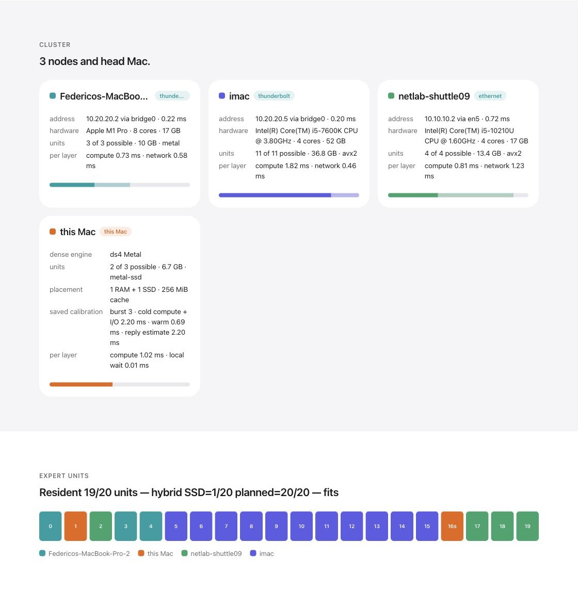
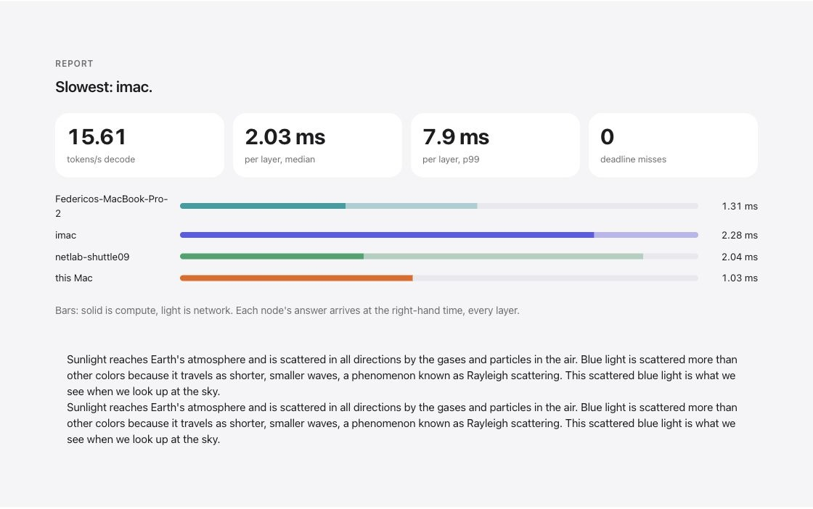

# The computers on my desk

These are the deliberately different machines used to develop and test Fronk.
The M4 Pro has a capable GPU but only 24 GiB of memory. The other computers
provide capacity and compute for experts, in shares measured for their own
backends. This is an example to learn from, not a shopping list.

## The RAM + SSD arrangement

| Computer | Hardware used | Installed RAM | Link to head | Allocation in the 2026-11-04 comparison |
|---|---|---:|---|---|
| MacBook Pro M4 Pro, head | Apple GPU: Metal dense engine and local expert worker | 24 GiB | Local | 2 RAM units + 1 SSD unit; 96 neurons/expert |
| Intel iMac | i5-7600K, 4 CPU cores, AVX2 | 48 GiB | Direct Thunderbolt, its own head port | 10 RAM units; 320 neurons/expert |
| MacBook Pro M1 Pro | Apple GPU: Metal expert worker | 16 GiB | Direct Thunderbolt, a separate head port | 3 RAM units; 96 neurons/expert |
| Linux Shuttle | i5-10210U, 4 cores / 8 threads, AVX2; Debian 13 | About 16 GB | 1 Gb/s Ethernet via a head USB adapter | 4 RAM units; 128 neurons/expert |

The 20 units cover all 640 neurons of every expert. Each native unit occupies
3,347,005,440 bytes; the head SSD share uses a 256 MiB expert cache. The Intel
machines use CPUs, while the Apple Silicon machines use integrated GPUs. The
head always keeps dense computation and attention on Metal in these tests.

Three warm short-prompt observations were **15.27, 15.72 and 15.50** streamed
fragments/s; after reconnect they were **14.47, 15.35 and 16.07**. All had the
same text and 62 fragments. These older measurements did not independently
count tokenizer tokens. A separate six-request baseline retained API token
counts and reached **15.79 decode tokens/s** on its fastest short response.
The [measurement guide](MEASUREMENTS.md) gives all controls, workloads and
counting methods. Thus “15–16 tok/s” describes the best short warm tests, not
every conversation or a new user's expected speed.

## A fresh packaged run, with real screenshots

The 2026-11-05 installer-to-chat run used the same four computers. Available
memory changed the allocation: **head 1 RAM + 1 SSD, iMac 11 RAM, M1 Pro 3 RAM,
Shuttle 4 RAM**. All 20 units participated. The console's short test reported
**15.61 tok/s**, with **zero deadline misses**. Three following requests each
reported 62 API completion tokens; their decode observations were 14.53,
15.74 and 14.91 tok/s. Time to first token was 1.55, 0.98 and 0.97 seconds.
The [small CSV](evidence/release-chat-20261105.csv) preserves the intervals.

These are captures of the running program, cropped to the relevant sections.
They show the fresh allocation, not the previous day's 2-RAM-unit head plan.

The filmed web-chat request used its normal system prompt and sampling. It
returned 78 tokens at about 11–12 decode tok/s, after a longer initial wait.
That result is shown as it happened; the 15.61 console test is a separate
measurement. Prompt length, selected experts, sampling, memory pressure and
warmth all affect the result.

## Why the iMac makes this an awkward cluster

The iMac has half the cluster's useful expert capacity in the earlier plan,
and 11 of 20 units in the fresh run. Its RAM is valuable, but its four CPU cores
must finish a large share at every layer. Capacity alone does not make a
balanced machine.

In the fresh console report, its mean expert computation was **1.822 ms** and
the reported link/return remainder **0.459 ms**, giving **2.281 ms** to arrival.
It was last in **1,009 of 1,296 barriers (77.9%)**. The Shuttle had **0.808 ms**
compute and **1.230 ms** link/return remainder; the M1 Pro arrived in **1.308 ms**.
These are observations from this test, not fixed hardware constants. The
remainder includes transport, scheduling and joining effects, not just time
on the cable.

More slices do **not** make a node's partial-sum reply larger: for the same
batch width it returns the same output vector. The iMac's memory-heavy share
unbalances completion times primarily through computation. A shared switch
can add a separate return-traffic bottleneck. This is why planning must consider
compute and link costs as well as RAM, and why moving one unit to measured
head SSD work can be useful. It does not mean any SSD placement is faster.

I would like to compare this with less lopsided clusters, especially several
small CPUs behind a properly provisioned head uplink. Use **Save cluster
report** in the console, add the cables and what you tried, then open a
[Cluster result issue](SHARE.md). A slower result with a clear explanation is
just as useful as a faster one.

[What if the nodes were all M1 Pro or ten small Shuttles?](PROJECTIONS.md)
uses the saved backend timings and an explicit head/network budget to make
that question testable. Its numbers are conditional projections, not measured
cluster results.
